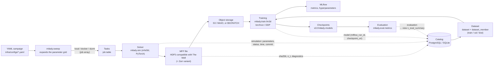
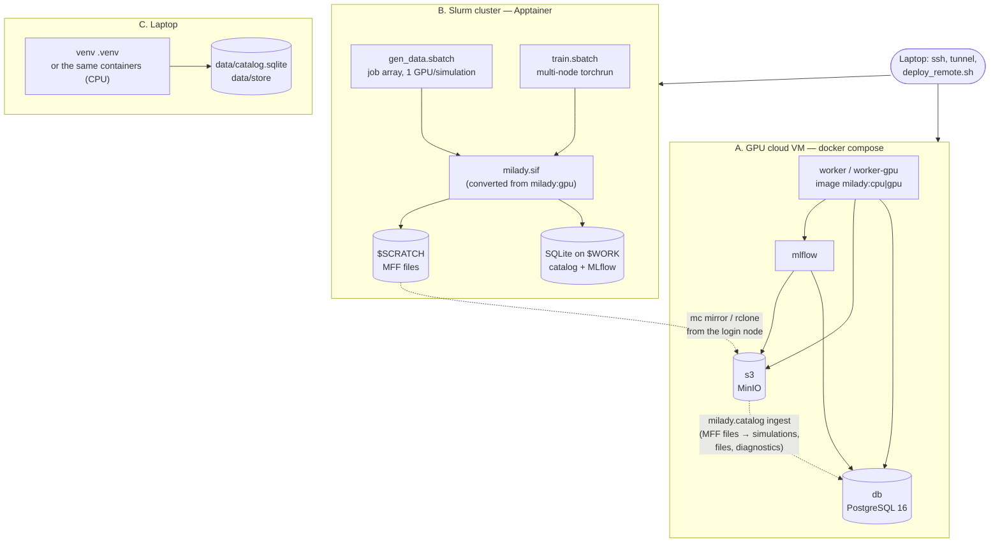

# MilaDy infrastructure architecture

Goal: produce **parametric MHD simulation campaigns** (2D then 3D), turn them into **datasets** in a
standard format, **train** conditional generative models under physical constraints and **evaluate** their
samples — reproducibly, on three targets (GPU cloud VM, Slurm cluster, laptop), with a trace of every
result in a catalog.

The contract (directory layout, MFF format, catalog schema) is in [`specs/infra.md`](specs/infra.md);
the user guide is in [`../infra/README.md`](../infra/README.md).

## 1. Data flow



The same thing in text:

```
YAML campaign ──► milady.sweep ──► jobs (local | docker | slurm --array)
                                     │
                                     ▼
                         milady.sim solver (CPU/GPU)
                                     │ writes
                                     ▼
              MFF file (HDF5, The Well + milady_* attributes) ──► S3 / MinIO / $SCRATCH
                                     │ registers (uuid, sha256, parameters, diagnostics)
                                     ▼
                     ┌──────────── catalog (PostgreSQL; SQLite offline) ───────────────────┐
                     │ campaign · simulation · file · diagnostic · job                    │
                     │ dataset · dataset_member ─► training (torchrun, MLflow) ─┐         │
                     │ model (mlflow_run_id, checkpoint_uri)  ◄─────────────────┘         │
                     │ evaluation ─► v_eval_summary (mean, standard deviation per metric) │
                     └────────────────────────────────────────────────────────────────────┘
```

Every object carries a **UUID**: the simulation receives the same identifier in the catalog and in the
file (`milady_uuid`), which makes it possible to rebuild or merge the simulations part of a catalog (simulations,
files, diagnostics; datasets, models, evaluations and tasks exist only in the catalog) from
the files alone (`python -m milady.catalog ingest --campaign <campaign>`), for example after a campaign on a cluster
without network access.

## 2. Deployment on the three targets



| | Cloud VM (A) | Slurm cluster (B) | Laptop (C) |
|---|---|---|---|
| Execution | Docker containers | Apptainer image (`.sif`) | venv or Docker |
| Image | `milady:gpu` (CUDA 12.6) / `milady:cpu` | conversion of `milady:gpu` | `milady:cpu` or PyPI packages |
| Catalog | PostgreSQL (`db`) | SQLite on `$WORK`; simulations then registered in PostgreSQL from the MFF files | SQLite `data/` |
| Files | S3 (MinIO or provider bucket) | `$SCRATCH` then S3 | `data/store` |
| Tracking | MLflow server | local SQLite MLflow | MLflow (optional) |
| Installation | `bootstrap_vm.sh` / cloud-init / `deploy_remote.sh` | `make sif` + `sbatch` | `make setup` |

**A single software image**: the VM's GPU image is the source of the cluster's Apptainer image;
the Python versions are pinned in `infra/env/requirements*.txt`. The repository is mounted in the
container (`/opt/milady`, editable install), so a code change does not require
rebuilding the image, and the commit (suffix `-dirty` if the tree was modified) is recorded in every MFF file,
in the checkpoints and in the catalog for simulations and models.

## 3. Technical choices

### Data format: HDF5 compatible with *The Well*, plus `milady_*` attributes

- *The Well* (Ohana et al., NeurIPS 2024, Datasets & Benchmarks; [data
  format](https://polymathic-ai.org/the_well/data_format/)) is a reference collection of
  physical simulations for learning, with a simple HDF5 convention: groups
  `dimensions/`, `boundary_conditions/`, `t0_fields/` (scalars), `t1_fields/` (vectors),
  `t2_fields/` (tensors), shapes `(trajectories, time, space…, components)`. Conforming to it makes our
  data readable by the community's reference loaders and models, and conversely.
- HDF5: self-describing format, compressed by chunks (reading one time step without loading everything),
  read everywhere (h5py, Julia, ParaView/VisIt, Fortran/C of simulation codes), serverless.
- MilaDy's own metadata (code, version, commit, JSON parameters, nondimensionalization, UUID,
  diagnostics, spectral coefficients) are attributes and groups prefixed `milady_`: invisible
  to a *The Well* reader, validated by a JSON schema (`src/milady/data/schema.json`).
- **Zarr** variant (same hierarchy) to read pieces from S3 without a full download.
- Extension `fourier_fe_axisym` for SFEMaNS (Fourier modes × meridian finite elements), without
  destructive interpolation.

### Catalog: PostgreSQL (SQLite in offline mode)

- The results of a thesis are **relational** (campaign → simulations → files → datasets →
  models → evaluations) and queried by physical parameters: PostgreSQL offers `JSONB`
  and its indexes for the parameters (Rm, Re, Pm…), integrity constraints, views
  (`v_eval_summary`) and safe concurrent writes from many jobs.
- The same SQLAlchemy model works on **SQLite**: portable mode and clusters without network, then
  ingestion into the central database from the files.
- A versioned schema file (`infra/db/schema.sql`) and readable SQL queries rather than an extra
  service. The SQLAlchemy model (`src/milady/catalog/models.py`) is its exact equivalent
  (columns, types, server-side `DEFAULT`, constraints, indexes, view), which a test on
  PostgreSQL checks.
- **Schema evolution**: `CREATE TABLE IF NOT EXISTS` and `create_all` never modify an existing
  table. As long as the schema is at version 1.0, a change is made identically in
  `schema.sql` and `models.py`. As soon as a database contains results to keep, switch to **Alembic**
  migrations (already among the dependencies): `alembic init infra/db/migrations`,
  `target_metadata = Base.metadata`, `alembic revision --autogenerate` reviewed by hand, then
  `alembic upgrade head` on the PostgreSQL database and on each cluster SQLite catalog.

### Object storage: S3 API (MinIO locally)

- The S3 API is the de facto standard: the same code (`fsspec`/`s3fs`) writes to MinIO on the VM, to
  an AWS S3, Scaleway or OVHcloud bucket, by changing only `MILADY_STORAGE_URI` and the access
  endpoint. Files are not rewritten in normal use (`--force` rewrites them, and `register_file` then
  updates their row and their SHA-256 checksum) and are addressed by a URI convention
  (`{campaign}/{uuid}/fields.h5`), which cleanly separates heavy data from metadata.
- **MinIO**: single-binary S3 server, suited to a VM. MinIO Inc. stopped publishing Docker images of the
  community edition at the end of 2025 (observed on 2026-11-07: `minio/minio` and
  `quay.io/minio/minio` can no longer be downloaded); the compose file
  uses the community fork `pgsty/minio` (same AGPLv3 code), replaceable via `MINIO_IMAGE`, by
  another S3-compatible server (SeaweedFS, Garage…) or by a provider bucket — MilaDy code
  depends only on the S3 API.

### Training tracking: MLflow

- Free, self-hostable, no external account: metrics, hyperparameters, artifacts and model
  registry. The server uses PostgreSQL (`mlflow` database) and S3 (`s3://mlflow`); it **proxies** the
  artifacts, so the compute containers do not need the S3 keys to log.
- On a cluster without Internet: local SQLite database (`sqlite:///$WORK/milady/mlflow.db`) that can be consulted
  afterwards; the link with the catalog goes through `model.mlflow_run_id`.

### Containers: Docker on VM, Apptainer on HPC

- **Docker Compose** is enough for a single VM (no Kubernetes to administer): healthchecks,
  named volumes, `cpu` / `gpu` / `jupyter` profiles, NVIDIA GPU reservation.
- **Apptainer / Singularity** is the standard of computing centers: rootless execution, image
  in a single `.sif` file, direct conversion from a Docker image, GPU access via `--nv`, host
  network (NCCL/InfiniBand). Jean Zay offers Singularity (Docker and Podman are not available there).
- Pinned base images: `python:3.12.15-slim-trixie` (CPU), `pytorch/pytorch:2.14.1-cuda12.6-cudnn9-runtime`
  (GPU), `postgres:16.14-bookworm`, `ghcr.io/mlflow/mlflow:v3.17.2`.

### Scheduling: Slurm (job arrays, `torchrun`)

- One simulation = one job array element (1 GPU): trivial parallelism, rerun of a failed
  element, limit on the number running at once (`--array=0-N%16`).
- Training: one `torchrun` per node with `MASTER_ADDR:MASTER_PORT` rendezvous; the same DDP
  code runs on 1 GPU (VM), 8 GPUs or several nodes (cluster).

## 4. Reproducibility and provenance

| Element | Where it is recorded |
|---|---|
| Code version | `milady_git_commit` (file), `simulation.git_commit`, `model.git_commit` |
| Dependencies | `infra/env/requirements*.txt` (lock), image tags |
| Physical parameters | `milady_parameters` (JSON, file) = `simulation.parameters` (JSONB) |
| Campaign configuration | `campaign.config_yaml` (YAML of the first launch); frozen copy of each launch in `data/sweeps/` |
| Machine and resources | `simulation.host`, `n_gpus`, `n_cpus`, `wall_time_s`, `job.external_id` (Slurm identifier) |
| Data integrity | `file.sha256`, `file.size_bytes` |
| Training | `model.hyperparams`, `model.dataset_id`, `model.mlflow_run_id`, `model.checkpoint_uri` |
| Evaluation | `evaluation.seed`, `n_samples`, `parameters`, `details` |

## 5. Security

No secret in the repository (`.env` generated on the machine, permissions 600, ignored by git); ports bound
to `127.0.0.1` and access through an SSH tunnel; application S3 account distinct from the administrator account;
compute containers, Jupyter and MLflow run without root (MinIO runs as root, with no port exposed outside
`127.0.0.1`); backups (`pg_dump` + S3 mirror) to an external target before any
VM deletion.
