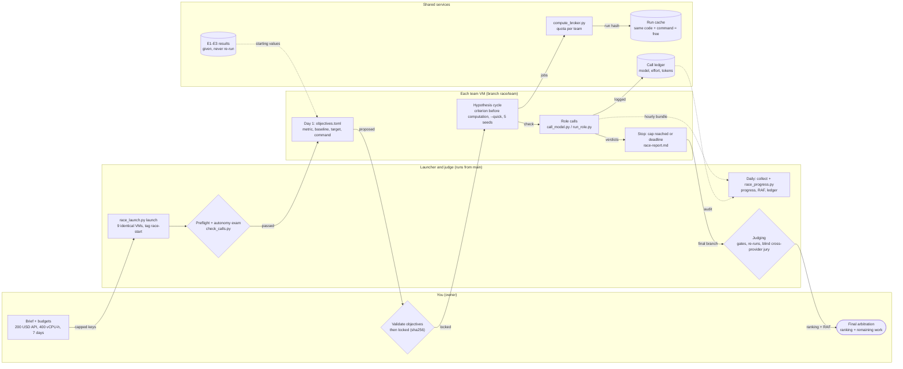

# The MilaDy race

Nine teams, one per provider, each running its provider's recommended coding harness, start from this repository at the tag `race-start` and try, for one week, to advance the research of the internship offer. Each team has the same budget: 200 USD of API calls (a spending cap in the provider's console) and 400 vCPU-hours of Scaleway compute through a shared broker. The prompt of every team is [`BRIEF.md`](BRIEF.md).

**Pilot first.** Before the nine-provider race, a single Claude Code cloud team runs the brief with GPU jobs on RunPod and full usage monitoring: [`PILOT.md`](PILOT.md), launch prompt in [`PILOT-PROMPT.md`](PILOT-PROMPT.md). The Scaleway launcher and broker below are for the full race and are not used by the pilot.

## How the week is organised

Interactive versions: [`diagrams/organisation.html`](diagrams/organisation.html) (the week) and [`diagrams/isolation.html`](diagrams/isolation.html) (isolation of one team, see [`ISOLATION.md`](ISOLATION.md)), rendered with [archify](https://github.com/tt-a1i/archify); download and open them in a browser.

## What each piece does

| Piece | Where it runs | What it guarantees |
|---|---|---|
| `race/BRIEF.md` | prompt of every team | same goal, rules and scoring for all |
| `race/config.toml` | read by every tool | deadline, budgets, machine types, team list |
| `race/objectives.common.toml` | day 1 | seven common objectives from the offer, same metric for all teams |
| `tools/race_launch.py` + `infra/deploy/race-team.sh` | your machine, then each team VM | one identical VM per team: harness installed, preflight, autonomy exam, then the harness re-invoked until the deadline; hourly git bundle published for collection; no GitHub or cloud credential on the VM |
| `tools/compute_broker.py` + `infra/deploy/race-job.sh` | a coordinator VM holding the Scaleway key | per-team vCPU-hour quota; a run with the same code (experiments/, src/, infra/env/), command and machine as an earlier one is served from the cache, for free and for any team; job VMs deleted after collection |
| `tools/call_model.py`, `tools/run_role.py`, `tools/check_calls.py` | team VMs, then the judge | every role call uses the model and effort its role prescribes, and the ledger proves it |
| `tools/race_progress.py` | a throwaway judge machine | lock of the objectives on day 1; daily progress `(value − baseline) / (target − baseline)` per objective, remaining work (RAF), ledger summary |

## Runbook

**Before the launch**

1. In each provider's console, create a key for the race and set a hard spending cap of 200 USD. Export each key under the variable named in `race/config.toml` `[teams]`.
2. Check the hourly prices of `POP2-4C-16G` (team VMs, 7 days each) and `POP2-HC-16C-32G` (broker jobs, 400 vCPU-hours = 25 h per team) on the Scaleway pricing page, and set the deadline in `race/config.toml`.
3. Merge, then tag the starting point: `git tag race-start && git push origin race-start`.

**Coordinator (broker)**

4. Start a small Scaleway VM with port 8080 open, holding `SCW_SECRET_KEY`; on it:
   `python3 tools/compute_broker.py tokens --state /srv/broker` then
   `python3 tools/compute_broker.py serve --state /srv/broker --public-url http://<coordinator-ip>:8080`.

**Pilot, then launch**

5. Launch one team first: `python3 tools/race_launch.py launch --team claude --broker-url http://<coordinator-ip>:8080 --state /srv/broker`. Watch `status.txt` until `preflight passed` and `exam passed`; read `preflight.txt` and `exam.txt` if not. Fix the harness entry of `agents/providers.toml` if its install or command fails.
6. Launch the eight other teams the same way. `python3 tools/race_launch.py plan` shows the model and effort each team and each role will use.

**Day 1**

7. `python3 tools/race_launch.py collect --team <team> --state /srv/broker --push` for every team, review `race/teams/<team>/objectives.toml` on `race/<team>`, then lock it from a checkout of that branch: `python3 tools/race_progress.py lock --team <team> --checkout <dir>`, and commit `race/locks.json` on `main`.

**Every day**

8. Collect every team, then, on a throwaway machine (measurement commands are the teams' code), check out each branch under `<dir>/<team>` and run `python3 tools/race_progress.py report --checkouts <dir>`. Keep the report: it is the daily progress and remaining work of each team.

**At the deadline**

9. Collect the final branches. For each team: run the gates (`tools/check_gates.py`, `make test`, `tools/check_calls.py ledger`), re-run its key computations through the broker, and run `jury-externe` with another provider on an anonymised copy of its `research/race-report.md` and claims (`MILADY_PROVIDER=<other> python3 tools/call_model.py --role jury-externe --task <file>`).
10. Arbitrate, then delete every VM: `python3 infra/deploy/scaleway.py cleanup`.

## Known limits

- **Not run end to end yet.** The tools are tested locally against a fake API server and a fake cloud (`tests/test_call_model.py`, `tests/test_race.py`). The harness install commands, headless flags and API base URLs come from the providers' documentation read on 2026-11-12; the pilot (step 5) is where they are confirmed.
- **Spend of the main session.** Role calls are in the ledger; the main session's own API calls are not. The provider's spending cap is the only hard limit; the launcher stops a team after three short failures in a row, which is what a reached cap looks like.
- **Isolation is designed, not built yet.** [`ISOLATION.md`](ISOLATION.md) compares the sandbox options (NVIDIA OpenShell, Docker Sandboxes, Anthropic sandbox-runtime, gVisor, Kata, Firecracker, hosted services) and recommends three layers: one VM per team on a private network, a gateway VM that alone holds the keys (egress allowlist, API proxy that injects keys and audits every call, broker), and the agent in a rootless Podman container under gVisor. The current launcher implements only the first layer.
- **Plain HTTP.** Team VMs, job VMs and the broker talk over plain HTTP with secret tokens and random paths. Put them in one Scaleway private network, or behind a TLS proxy, if that is not acceptable.
- **Untrusted code.** Measurement commands and job commands are written by the teams' agents: run `race_progress.py` on a throwaway machine, never where keys live.
- **Fairness of targets.** Each team sets its own targets; the common objectives are therefore also compared across teams on their raw values, not only on progress.
