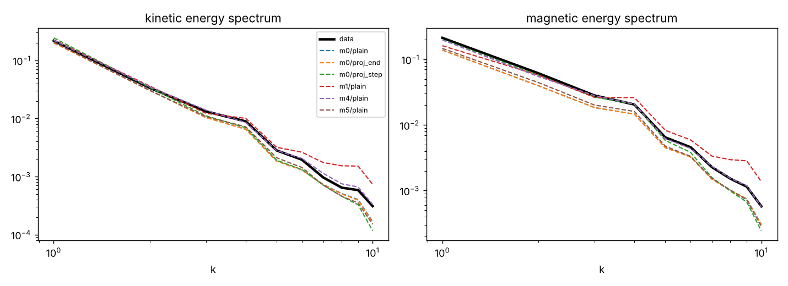
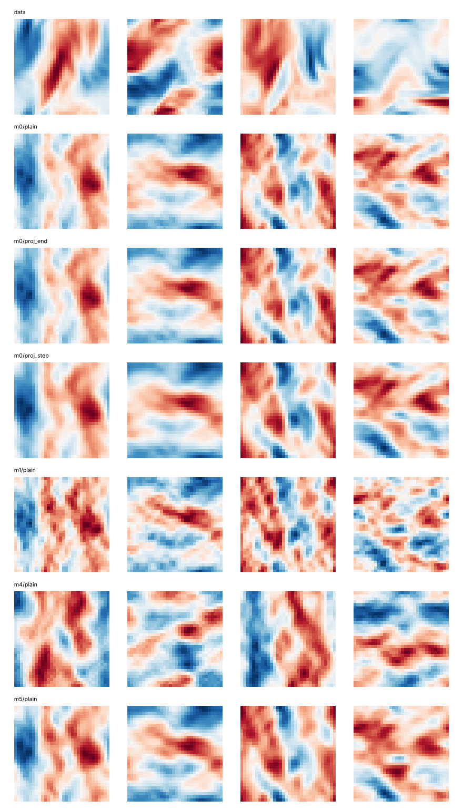

> Report of an automated race team, copied as the team left it (delivered at 01:50 UTC after 1.31 h). Delivery: private dataset knoel/milady-20261115-race-anthropic-delivery on the Hugging Face Hub; [delivery record, decisions and costs](https://github.com/knoel99/milady-2027/tree/main/research/teams/anthropic).

**Status: small, under-trained, single-seed pilot. Differences between strategies are descriptive, NOT statistically established.**

## What was done (all measured here; code in `src/`, outputs in `results/`)
- **Data** (`src/mhd2d.py`, `src/gen_data.py`): own pseudo-spectral 2-D incompressible MHD solver on a 32x32 periodic grid, 3200 runs with random (log10 nu, log10 eta); fields (u, b) at a fixed final time. Split: 2211 train / 300 in-distribution test / 689 held-out band of log10 nu in (-1.9,-1.7) ("band", interpolation test). Ideal-limit energy conservation checked to ~1e-6 relative (earlier session check; log not kept in `results/`).
- **Model** (`src/fm.py`): conditional flow matching (linear path, 50 Euler steps), small circular-padded U-Net (width 24) with FiLM conditioning on (log nu, log eta) and time; EMA weights; **400 training steps, batch 32, 1 seed (0)**, CPU.
- **Strategies for the divergence-free constraint**: M0 unconstrained; M0+proj_end (post-hoc Leray projection of the samples); M0+proj_step (Leray projection after every sampling step); M1 soft penalty (lambda=1) on the divergence of the one-step denoised estimate (in the spirit of Bastek et al. 2025); M4 hard constraint by generating stream function / magnetic potential; M5 projection layer (projected noise and network velocity).
- **Metrics** (`src/evalm.py`): relative divergence, shell energy spectra (log error, all k and high k), 1-D Wasserstein distances of energy, dissipation nu<w^2>+eta<j^2>, cross-helicity, mean-square potential <A^2>, critical-point counts of A (topology), slope of high-k energy fraction vs log nu (parameter conditioning). "data_floor" = same metrics for a random real-data subset vs the test set (sampling-noise floor; parameters differ so it is only indicative).

## Results (`results/table.md`, figures `results/fig_spectra.png`, `results/fig_fields.png`)
Test set `in` (mean over 1 seed, so no ± ):

| method | div_rel | spec_logerr | spec_logerr_hik | W1_energy | W1_dissip | W1_nO | slope (data -0.32) |
|---|---|---|---|---|---|---|---|
| data floor | 3e-7 | 0.028 | 0.029 | 0.033 | 0.007 | 0.47 | -0.24 |
| M0 plain | 0.116 | 0.158 | 0.180 | 0.186 | 0.042 | 3.63 | -0.19 |
| M0 + proj_end | 4e-7 | 0.161 | 0.185 | 0.186 | 0.042 | 3.63 | -0.19 |
| M0 + proj_step | 5e-7 | 0.135 | 0.216 | 0.155 | 0.035 | 2.65 | -0.27 |
| M1 soft | 0.077 | 0.173 | 0.289 | 0.225 | 0.071 | 10.1 | +0.06 |
| M4 stream fn | 4e-7 | **0.024** | **0.030** | **0.116** | **0.035** | 6.59 | -0.07 |
| M5 proj. layer | 7e-7 | 0.150 | 0.194 | 0.190 | 0.044 | 3.21 | -0.24 |

Observations (measured, single seed):
1. Divergence: hard/projection methods reach ~1e-7 (float32 round-off, same as data); the unconstrained net has 12 % relative divergence; the soft penalty only reduces it to 7.7 % at lambda=1 after 400 steps.
2. Post-hoc projection (proj_end) fixes divergence and leaves all other metrics unchanged (to 3 digits) in this run.
3. The stream-function parametrisation (M4) gives by far the best spectra (log error 0.024 on `in`, near the noise floor, and also best on `band`: 0.086 vs 0.11-0.22) and best energy/dissipation W1, but the worst critical-point count error among the hard-constraint methods and a conditioning slope (-0.07) farther from the data's than M5 / proj_step.
4. M1 is the worst on spectra high-k, dissipation and topology here; with this budget the loss-based constraint does not pay off.
5. Topology counts are far from the noise floor for all methods (W1_nO 2.7-10 vs 0.5), and the data's own |nO-nX| (6.5) shows our discrete detector over-counts saddles; we only trust gen-vs-data count comparisons, not Euler-balance. 
6. Held-out band: same ranking for spectra (M4 best); table in `results/table.md`.

## Limits and honest caveats
- 2-D (not 3-D), 32x32, 400 optimiser steps, width-24 net, **one seed, no confidence intervals**; all methods far from the data noise floor except M4's spectra. Rankings may change with longer training/more seeds.
- A first 1500-step batch was abandoned (time, shared CPU); its M1 variant had a bug (penalty term inside a comment, M1 ≡ M0), found and fixed; no number from it is reported. See `DECISIONS.md`.
- Energy balance is only checked statistically (energy, dissipation); helicity in 2-D is replaced by cross-helicity and <A^2> (kinetic/magnetic helicity vanish identically in 2-D).
- Cloud GPU (Runpod) failed (HTTP 502 tunnel errors) earlier in the mission; no cloud spend.
- Not implemented: Fundiff/function-space diffusion, universal guidance, reduced-order models (cited from the subject's reference list only, not re-read here); no published-result comparison is made.

## AI use
Everything (solver, code, experiments, this report) was produced autonomously by Claude Sonnet 5.5 in the Claude Code harness; no sub-agents or other models were used.

## Figures

The figures the report describes, as delivered.

{#fig-1 width=100%}

{#fig-2 width=100%}
