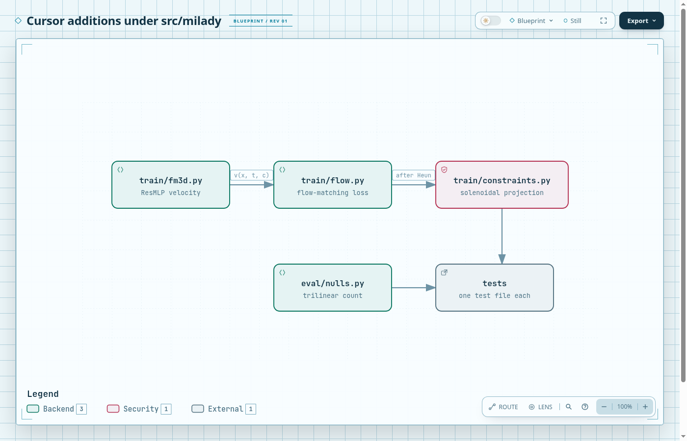
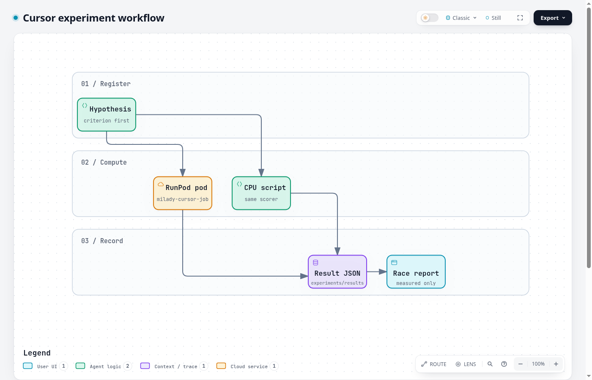
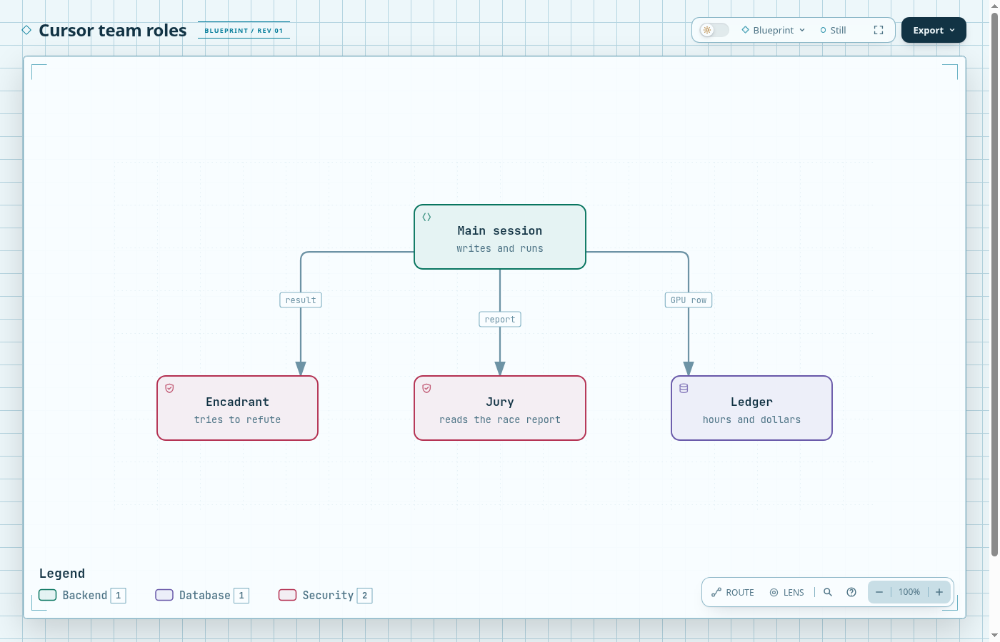

The PDF of this page is [index.pdf](index.pdf){download="milady-2027-cursor-report.pdf"}. The explorer is [../explorer/index.html](../explorer/index.html).

# Abstract {#abstract}

This report records what team cursor measured while preparing the MilaDy internship. The scientific object is a physics-constrained generator of parametric magnetohydrodynamic fields. The measurements that can be quoted today split into two families.

The first family is a kinematic ABC dynamo. Growth-rate signs depend on the seed, the magnetic Reynolds number, and the grid. Several brackets are closed. Several remain open. Those runs are not a generator result.

The second family scores ensembles of magnetic fields at $n = 16$ and held-out $Rm = 12$. A small conditional flow, trained for forty Adam steps, meets a divergence comparison and misses the energy-distance target by about two orders of magnitude. A perfect Fourier cutoff and a linear midpoint in coefficient space meet that target. A dynamic ABC window meets the total energy balance and misses the magnetic residual. A trilinear null count is preserved, at the pre-registered tolerance, only by the kmax=7 midpoint.

A ResMLP conditional flow, hypothesis H168, was then trained for 4000 Adam steps on a GPU. Its five-seed mean energy-distance ratio is 0.769, which meets 1.2. Seed 0 alone is 1.508. The same-kmax Fourier midpoint on that run has mean 0.743. The learned mean C4 is 0.310 and misses 0.1. That C4 figure is measured. It was not a registered criterion.

Every number below is measured in a committed result file, published with a reference, or marked conjectured. The file `experiments/results/cursor_metrics.json` stores the H168 learned mean as C1. It still stores the kmax=6 midpoint for C2 and C4, because the learned C4 misses 0.1. C3 is the dynamic total residual. C5 is the kmax=7 midpoint null error.

# Introduction {#introduction}

The internship offer asks for conditional generative models of parameter-dependent fields, with constraints imposed by model design, by the training loss, or by the sampling procedure, and with a comparative study on spectra, helicity, divergence, and topology. The local statement of that offer is in `docs/specs/sources/literature.md`. This page is the cursor team's report of the measurements made toward that study. The living summary of the same measurements is `research/race-report.md`.

The work started from the kinematic ABC problem because the sign of the growth rate is a sharp, cheap test of the solver. It then moved to the generator metrics, because a sign bracket does not train a model. The generator comparisons use one held-out parameter, $Rm = 12$, five seeds, and the same scoring function for every mechanism.

Three facts organise the rest of the report. A sampling projection removes the longitudinal Fourier component and cuts the divergence. The same small networks do not match the held-out ensemble in energy distance. A linear operation in Fourier space, either a perfect cutoff of the reference field or a midpoint between the two neighbouring Reynolds numbers, does match that distance, and only the finest of those midpoints also matches the null count.

The pipeline, the open dynamo bracket, the constraint glyphs, the metric panel, the protocol, the balance, the null count, and the compute path are drawn in `figures/pipeline-panel/`, `figures/dynamo-threshold/`, `figures/constraint-mechanisms/`, `figures/metrics-panel/`, `figures/protocol-panel/`, `figures/balance-panel/`, `figures/null-panel/`, and `figures/compute-path/`. Each of those directories holds a `figure/figure.js` source, a brief, a specification, and both an SVG and a PDF render. Data plots of the same result files are in `plots/`.

# State of the art {#state-of-the-art}

The published statements used here are the ones collected in `docs/specs/sources/` and `docs/specs/theory-brief.md`. This section does not add a claim that those files mark unconfirmed.

Flow matching trains a velocity on a conditional path without differentiating through the solver. Lipman, Chen, Ben-Hamu, Nickel, and Le, Flow Matching for Generative Modeling, ICLR 2023, arXiv:2210.02747, is the published reference used for that loss. The local note is `docs/specs/sources/literature.md`. The path used in this repository is the linear interpolant $x_t = (1-t) x_0 + t x_1$, with $x_0$ a standard Gaussian, which is also the rectified-flow path of Liu, Gong, and Liu, ICLR 2023, arXiv:2209.03003.

A field can be made divergence-free by construction. Richter-Powell, Lipman, and Chen, Neural Conservation Laws, NeurIPS 2022, arXiv:2210.01741, is the published construction by differential forms. The mechanism measured here is narrower. `project_solenoidal` removes the longitudinal Fourier component of a periodic field. That is a spectral Helmholtz projection, not the neural conservation law, and it is applied as a sampling constraint after each Heun step.

The stationarity constraint is not the instantaneous identity $\mathrm{d}E/\mathrm{d}t = P - \varepsilon$. Theory brief Proposition 5 says that an invariant law has mean zero for the generator applied to a smooth observable, and that the mean energy balance is the case of the energy. The same brief says that the instantaneous balance is an identity, and that the constraint is the expectation. The magnetic residual and the total residual are therefore different claims. Both are measured below. Only the total residual on the dynamic window meets 0.05.

Nulls are the zeros of a trilinear interpolant on each periodic cell. The published method is Haynes and Parnell, Physics of Plasmas 14, 082107 (2007), as recorded in `docs/specs/sources/data-metrics.md`. The implementation is `src/milady/eval/nulls.py`. It is not a sign-change octree, and it is not Greene's 1992 method.

No published dynamo threshold is restated here. The kinematic signs in this repository are measured growth rates of one solver. Where a sentence is only a guess about a run that is not in the result files, it is marked conjectured.

# Methods {#methods}

## Scoring

One function scores every ensemble. `score` in `experiments/cursor_constraint_cmp.py` calls `compare_ensembles` on the magnetic field. The energy-distance ratio, called C1 in the result files, is `energy_distance` divided by `energy_distance_floor` from that comparison. The floor is the distance of the reference ensemble to a subsample of itself. A ratio near 1 means the generated cloud is as far from the reference as the reference is from its own subsample. The objective target used in the hypotheses is 1.2.

The maximum relative divergence is the maximum, over the generated samples, of `divergence_relative`. C4 is the relative $L^2$ error of the shell spectrum of $B$ plus the relative error of the mean magnetic helicity. In the constraint files, the key `c3` is the absolute magnetic balance residual returned by `compare_ensembles`. That is not the total residual used for the quoted objective C3. The quoted total residual comes only from `experiments/results/cursor_stationary.json`.

## Three mechanisms

The sampling constraint removes the longitudinal Fourier component after every Heun step. The unconstrained baseline uses the same network, the same data, and the same seed, and does not project. Both are small conditional flows. The early runs use a two-layer network, hidden width 64 unless a file says otherwise, forty Adam steps, and four or eight snapshots. Those runs are the ones whose energy-distance ratio stays near 750. They are measured. They are not an acceptable generator.

The design comparison is a cutoff in wavenumber. A perfect cutoff keeps the modes of the reference field inside the ball and drops the rest. No network is trained. A linear midpoint averages the packed coefficients of the fields at $Rm = 11$ and $Rm = 13$, at the same time, and unpacks the average. $Rm = 12$ is not an input of that average. The midpoint is a baseline. `cursor_metrics.json` currently points C1, C2, and C4 at the kmax=6 midpoint because that file was written before a trained model had a finite five-seed score under 1.2.

The stationarity window is the second half of a dynamic ABC run at $n = 16$, $t = 8$, $\nu = \eta = 0.05$, and a seed field of amplitude $10^{-3}$. The first half is the transient baseline. The total residual is the mean of injection minus viscous dissipation minus ohmic dissipation, divided by the mean of the two dissipations. The magnetic residual keeps the exchange term and subtracts no growth rate. The code path is `budget_summary` with laminar ABC forcing and $U_{\mathrm{ref}} = 1$.

## The registered learned model

H168 asks whether a wider conditional flow meets the same C1 bound. The network is `milady.train.fm3d.ResMLP`, width 256, depth 4, embedding 128, eight Fourier features, six channels. The loss is `fm_loss`. The sampler is `heun_sample` with 32 steps. After each step the physical coefficients are projected with `project_solenoidal` and mapped back to the normalized coordinates. Each seed is normalized by its own mean and standard deviation. Training Reynolds numbers are 8, 10, 11, 13, 14, and 16. Times are eight values from 0.25 to 2. Held-out $Rm$ is 12. Seeds are 0 to 4. The optimizer is Adam for 4000 steps, batch 32, learning rate $10^{-3}$. The Fourier midpoint of $Rm = 11$ and $Rm = 13$ is scored by the same function at the same cutoff. The criterion, fixed before the run, is refuted if any learned ratio is non-finite or if the five-seed mean exceeds 1.2.

A one-seed probe with 200 steps is recorded in the hypothesis origin. It is not a quoted result. The five-seed GPU run is the quoted protocol. Its file is `experiments/results/cursor_fm/metrics.json`.

## Nulls

On each periodic cell the magnetic field is replaced by its trilinear interpolant. A root is kept when that interpolant is numerically zero. A root on the upper face is left to the neighbouring cell so that a periodic root is not counted twice. The relative error is the absolute difference of the two counts divided by the full-field count. The tolerance fixed before H164 was 0.1.

## What the figures show

::: {.content-visible when-format="html"}
{width=92%}
:::

::: {.content-visible when-format="pdf"}
{width=92%}
:::

::: {.content-visible when-format="html"}
{width=92%}
:::

::: {.content-visible when-format="pdf"}
{width=92%}
:::

::: {.content-visible when-format="html"}
{width=92%}
:::

::: {.content-visible when-format="pdf"}
{width=92%}
:::

::: {.content-visible when-format="html"}
{width=92%}
:::

::: {.content-visible when-format="pdf"}
{width=92%}
:::

# Experiments {#experiments}

## Grids and seeds

Kinematic ABC runs use float64, $t = 120$, a time-step cap of 0.05, and CFL 1 unless a result file says otherwise. A point is kept when it is finite and the final $\max|\nabla\cdot B|$ is below $10^{-8}$. GPU jobs of this team are named `milady-cursor-job-*`. Pods of the other team are not touched.

Generator comparisons are CPU runs at $n = 16$ unless they are H168. Seeds are 0, 1, 2, 3, and 4 whenever a comparison is quoted. The standard error in the comparative table is the sample standard deviation divided by the square root of 5. It is computed from the five seed values in the named JSON file. It is not a second experiment.

$Rm = 12$ is held out of every learned training set and is not an endpoint of a midpoint. Training values used by the small flows are the pairs or the grids named in each result file. H168 trains at 8, 10, 11, 13, 14, and 16.

## Protocol panel and compute path

::: {.content-visible when-format="html"}
{width=92%}
:::

::: {.content-visible when-format="pdf"}
{width=92%}
:::

::: {.content-visible when-format="html"}
{width=92%}
:::

::: {.content-visible when-format="pdf"}
{width=92%}
:::

## What was run

The small-flow file is `experiments/results/cursor_constraint_cmp.json` (kmax=2, forty steps). The kmax=4 width-64 file is `cursor_constraint_kmax4.json`. The wide hidden layer is `cursor_constraint_wide.json`. The six training Reynolds numbers at kmax=4 are `cursor_constraint_dense.json`. Perfect cutoffs are `cursor_constraint_ceiling.json`. Midpoints are `cursor_constraint_midpoint.json`, `cursor_constraint_midpoint_kmax6.json`, and `cursor_constraint_midpoint_kmax7.json`. The dynamic window is `cursor_stationary.json`. Null counts are `cursor_nulls.json`, `cursor_nulls_kmax6.json`, `cursor_nulls_midpoint_kmax6.json`, and `cursor_nulls_midpoint_kmax7.json`.

H168 is `experiments/cursor_fm_train.py` with `--device cuda --steps 4000`. The first pod, `vf94e6g28iv9mw`, exited in 88 seconds because a mean tensor was on CUDA while the coefficients were still on CPU. The log is `research/gpu-logs/h168.log`. That row costs 0.0603 USD and is not a score. The subtraction was then moved onto the requested device. The criterion was not changed. The rerun is pod `1lzm2p635n6com`, 0.1656 hours, 0.1474 USD, exit code 0. The file is `experiments/results/cursor_fm/metrics.json`.

# Results {#results}

## Divergence and the small flows

Measured, file `experiments/results/cursor_constraint_cmp.json`. The sampling constraint has mean maximum relative divergence $1.560\times 10^{-8}$ (SE $2.60\times 10^{-9}$). The free baseline has mean $0.6454$ (SE $0.0048$). H145 is confirmed. The same projected variant has mean energy-distance ratio 757.56 (SE 1.83). H146 is refuted. All five projected ratios are finite and all of them sit between 753 and 764.

Raising the cutoff at hidden width 64 does not help. File `cursor_constraint_kmax4.json`, projected mean ratio 791.02 (SE 1.80). That mean is larger than 757.56, so H147 is refuted, and it is above 1.2, so H148 is refuted. A hidden width equal to the packed dimension, file `cursor_constraint_wide.json`, brings the mean to 787.34 (SE 1.01). That is strictly smaller than the width-64 mean, so H149 is confirmed, and it is still above 1.2, so H150 is refuted. Training at six Reynolds numbers, file `cursor_constraint_dense.json`, gives 781.66 (SE 1.55). H154 is confirmed on the inequality against the wide baseline. H155 is refuted on the bound 1.2.

The per-seed projected ratios are the values the means come from.

| Seed | kmax=2 | kmax=4, width 64 | wide | dense Rm |
| --- | --- | --- | --- | --- |
| 0 | 758.853 | 793.478 | 786.250 | 783.277 |
| 1 | 758.504 | 789.790 | 787.853 | 784.603 |
| 2 | 763.250 | 787.471 | 787.077 | 780.156 |
| 3 | 753.071 | 796.741 | 790.792 | 784.015 |
| 4 | 754.139 | 787.603 | 784.737 | 776.260 |

::: {.content-visible when-format="html"}
{width=88%}
:::

::: {.content-visible when-format="pdf"}
{width=88%}
:::

::: {.content-visible when-format="html"}
{width=88%}
:::

::: {.content-visible when-format="pdf"}
{width=88%}
:::

## Fourier ceiling and midpoint

Measured, file `cursor_constraint_ceiling.json`. A perfect cutoff of the reference field has mean ratio 0.7278 at kmax=4 (SE 0.279), $9.185\times 10^{-3}$ at kmax=6 (SE $3.91\times 10^{-3}$), and $2.808\times 10^{-3}$ at kmax=7 (SE $1.18\times 10^{-3}$). H151, H152, and H153 are confirmed. Seed 0 at kmax=4 is 1.752, above 1.2. The criterion is the mean, and the mean is under 1.2. This is a measurement of a truncation of the reference, not of a model that never saw the reference.

Measured, file `cursor_constraint_midpoint.json`. The kmax=4 midpoint has mean ratio 0.7431 (SE 0.287). H156 says that mean is strictly smaller than the dense learned baseline 781.66. It is. H157 says the same mean is at most 1.2. It is. The earlier draft of this report attached H157 to the kmax=6 midpoint. That attachment was wrong. H157 is the kmax=4 midpoint.

Measured, file `cursor_constraint_midpoint_kmax6.json`. The kmax=6 midpoint has mean ratio 0.0140 (SE 0.0060), mean C4 $9.293\times 10^{-3}$ (SE $3.13\times 10^{-3}$), and mean maximum relative divergence $4.219\times 10^{-16}$ (SE $1.13\times 10^{-17}$). H158 and H159 are confirmed on C4. There is no separate registered hypothesis whose statement is the kmax=6 energy-distance bound. The number is measured, and `cursor_metrics.json` stores C1 as 0.013966666402533533 from this file. The same file's mean absolute magnetic residual is 0.0834 (SE 0.0241). H160, which asked for that residual to be at most 0.05, is refuted.

Measured, file `cursor_constraint_midpoint_kmax7.json`. The kmax=7 midpoint has mean absolute magnetic residual 0.0852 (SE 0.0230), which is not below the kmax=6 value and is above 0.05. H161 is refuted. The cutoff is not the lever for that kinematic magnetic residual.

| Seed | cutoff kmax=4 | cutoff kmax=6 | midpoint kmax=4 | midpoint kmax=6 |
| --- | --- | --- | --- | --- |
| 0 | 1.75195 | 0.021342 | 1.79787 | 0.034779 |
| 1 | 0.51408 | 0.005499 | 0.52203 | 0.008560 |
| 2 | 0.28340 | 0.001926 | 0.28721 | 0.003228 |
| 3 | 0.86026 | 0.015349 | 0.87530 | 0.019840 |
| 4 | 0.22914 | 0.001810 | 0.23324 | 0.003427 |

::: {.content-visible when-format="html"}
{width=88%}
:::

::: {.content-visible when-format="pdf"}
{width=88%}
:::

::: {.content-visible when-format="html"}
{width=88%}
:::

::: {.content-visible when-format="pdf"}
{width=88%}
:::

::: {.content-visible when-format="html"}
{width=88%}
:::

::: {.content-visible when-format="pdf"}
{width=88%}
:::

## Energy balance

::: {.content-visible when-format="html"}
{width=92%}
:::

::: {.content-visible when-format="pdf"}
{width=92%}
:::

Measured, file `cursor_stationary.json`. On the second half, the mean absolute total residual is $3.744\times 10^{-6}$ (SE $1.36\times 10^{-6}$). H162 is confirmed. The mean absolute magnetic residual on the same window is 0.0675 (SE 0.0162). H163 is refuted. The five magnetic residuals are all negative. The total residuals are all negative and all smaller than $10^{-5}$ in absolute value. The objective C3 quoted in `cursor_metrics.json` is the total residual, $3.7436517166459855\times 10^{-6}$, not the magnetic one.

| Seed | absolute total, second half | absolute magnetic, second half |
| --- | --- | --- |
| 0 | 7.298e-6 | 0.07018 |
| 1 | 2.603e-6 | 0.11074 |
| 2 | 9.840e-7 | 0.05256 |
| 3 | 1.152e-6 | 0.08823 |
| 4 | 6.682e-6 | 0.01556 |

The seed table is the absolute value of the signed residual stored in the file. The means above are the means of those absolute values.

::: {.content-visible when-format="html"}
{width=88%}
:::

::: {.content-visible when-format="pdf"}
{width=88%}
:::

## Null counts

::: {.content-visible when-format="html"}
{width=92%}
:::

::: {.content-visible when-format="pdf"}
{width=92%}
:::

Measured. The full field at $Rm = 12$, eight times, has null counts 36, 26, 32, 34, and 32 on seeds 0 to 4. File `cursor_nulls.json`. The kmax=4 truncation of the same fields has counts 34, 46, 30, 66, and 42. The mean relative error is 0.4282 (SE 0.182). H164 is refuted. File `cursor_nulls_kmax6.json` has truncated counts 30, 24, 36, 38, and 42, and mean relative error 0.1597 (SE 0.0408). H165 is refuted. Two truncation widths missed 0.1, so that comparison was dropped.

The midpoint is a different comparison. It is scored against the held-out field, not against a truncation of that same field. File `cursor_nulls_midpoint_kmax6.json`, mean relative error 0.1715 (SE 0.0247). H166 is refuted. File `cursor_nulls_midpoint_kmax7.json`, mean relative error 0.0840 (SE 0.0119). H167 is confirmed. `cursor_metrics.json` stores C5 as 0.08397460868851093 from that file. The coarser counts remain misses.

| Seed | full count | kmax=4 count | kmax=4 relative | kmax=7 midpoint relative |
| --- | --- | --- | --- | --- |
| 0 | 36 | 34 | 0.0556 | 0.1214 |
| 1 | 26 | 46 | 0.7692 | 0.0712 |
| 2 | 32 | 30 | 0.0625 | 0.1023 |
| 3 | 34 | 66 | 0.9412 | 0.0622 |
| 4 | 32 | 42 | 0.3125 | 0.0627 |

::: {.content-visible when-format="html"}
{width=88%}
:::

::: {.content-visible when-format="pdf"}
{width=88%}
:::

::: {.content-visible when-format="html"}
{width=88%}
:::

::: {.content-visible when-format="pdf"}
{width=88%}
:::

## The learned flow

Measured, file `experiments/results/cursor_fm/metrics.json`. Five seeds, 4000 steps, kmax=4, held-out $Rm = 12$. The learned energy-distance ratios are 1.5078, 0.6832, 0.7370, 0.6482, and 0.2703. The mean is 0.7693 (SE 0.2022). H168 is confirmed. The criterion is the mean. Seed 0 is above 1.2 and does not refute the claim.

The same file scores the kmax=4 midpoint on the same eight times. Its mean ratio is 0.7431 (SE 0.2869), which matches `cursor_constraint_midpoint.json`. The learned mean does not beat that midpoint. The learned mean maximum relative divergence is $1.987\times 10^{-8}$ (SE $7.71\times 10^{-10}$). The learned mean C4 is 0.3098 (SE 0.0783), above 0.1. The learned mean absolute magnetic residual is 0.1077 (SE 0.0330), above 0.05. Those two misses are measurements. They were not the H168 criterion, and they are why `cursor_metrics.json` does not replace C4 with the learned number.

| Seed | learned C1 | midpoint C1 | learned C4 |
| --- | --- | --- | --- |
| 0 | 1.50779 | 1.79787 | 0.23217 |
| 1 | 0.68322 | 0.52203 | 0.24004 |
| 2 | 0.73696 | 0.28720 | 0.62289 |
| 3 | 0.64820 | 0.87530 | 0.23228 |
| 4 | 0.27034 | 0.23324 | 0.22150 |

## Solver timing

Measured, `research/gpu-logs/bench-float32.log`. One step of `milady.sim.mhd3d` at $n = 128$, float32, on an RTX 4090, takes 0.008683746322058141 seconds. The T1 target in the team objectives is 0.05. This bench meets it. The same log records 0.006443568398244679 seconds at $n = 64$.

Measured, `research/gpu-logs/bench-float64.log`. The float64 companion at $n = 128$ takes 0.04840661495923996 seconds per step on an RTX PRO 4500. There is no T2 row in `race/teams/cursor/objectives.toml`. The number is a bench, not an objective id.

## Kinematic signs, in one paragraph

Measured growth rates, not a generator. At $n = 128$ and $Rm = 9$, seeds 0 to 4 are positive (H102). At $n = 136$ the same $Rm$ has negative seeds (H141). At $n = 128$, seeds 0 to 4, the growth rate is negative at $Rm = 8.98699951171875$ (H144, seed 0, $\lambda = -7.53\times 10^{-7}$) and positive at $Rm = 8.9871826171875$ (H142). That bracket is open and is not bisected. The same decision applies to the other open brackets recorded in the race report. H144 is refuted as a claim that every seed would be positive at the lower $Rm$. Its verdict is a sign, not a C6 comparison of two mechanisms.

# Comparative study {#comparative-study}

The table is one mechanism or model family against one metric. The mean and the standard error use the five seeds in the result file named in the results chapter. CONFIRMED means the pre-registered criterion was not met by the data, so the claim holds. REFUTED means the criterion was met.

| Mechanism | Metric | Mean ± SE | Verdict |
| --- | --- | --- | --- |
| sampling constraint, kmax=2 | max relative divergence | 1.560e-08 ± 2.603e-09 | H145 CONFIRMED |
| free baseline, kmax=2 | max relative divergence | 0.6454 ± 0.0048 | control of H145 |
| sampling constraint, kmax=2 | energy-distance ratio | 757.56 ± 1.83 | H146 REFUTED |
| sampling constraint, kmax=4, width 64 | energy-distance ratio | 791.02 ± 1.80 | H147 REFUTED, H148 REFUTED |
| sampling constraint, kmax=4, wide | energy-distance ratio | 787.34 ± 1.01 | H149 CONFIRMED, H150 REFUTED |
| sampling constraint, dense Rm | energy-distance ratio | 781.66 ± 1.55 | H154 CONFIRMED, H155 REFUTED |
| perfect cutoff kmax=4 | energy-distance ratio | 0.7278 ± 0.2791 | H151 CONFIRMED |
| perfect cutoff kmax=6 | energy-distance ratio | 9.185e-03 ± 3.914e-03 | H152 CONFIRMED |
| perfect cutoff kmax=7 | energy-distance ratio | 2.808e-03 ± 1.180e-03 | H153 CONFIRMED |
| midpoint kmax=4 | energy-distance ratio | 0.7431 ± 0.2869 | H156 CONFIRMED, H157 CONFIRMED |
| midpoint kmax=4 | C4, spectrum plus helicity | 0.1498 ± 0.0366 | baseline of H158 |
| midpoint kmax=6 | C4, spectrum plus helicity | 9.293e-03 ± 3.128e-03 | H158 CONFIRMED, H159 CONFIRMED |
| midpoint kmax=6 | absolute magnetic residual | 0.0834 ± 0.0241 | H160 REFUTED |
| midpoint kmax=6 | energy-distance ratio | 0.0140 ± 0.0060 | measured in the midpoint file |
| midpoint kmax=7 | absolute magnetic residual | 0.0852 ± 0.0230 | H161 REFUTED |
| dynamic second half | absolute total residual | 3.744e-06 ± 1.358e-06 | H162 CONFIRMED |
| dynamic second half | absolute magnetic residual | 0.0675 ± 0.0162 | H163 REFUTED |
| kmax=4 truncation | relative null-count error | 0.4282 ± 0.1824 | H164 REFUTED |
| kmax=6 truncation | relative null-count error | 0.1597 ± 0.0408 | H165 REFUTED |
| kmax=6 midpoint | relative null-count error | 0.1715 ± 0.0247 | H166 REFUTED |
| kmax=7 midpoint | relative null-count error | 0.0840 ± 0.0119 | H167 CONFIRMED |
| ResMLP flow, sampling constraint, kmax=4 | energy-distance ratio | 0.7693 ± 0.2022 | H168 CONFIRMED |

Reading the table as a comparison of mechanisms, the sampling projection wins on divergence and loses on energy distance. Width, cutoff, and a denser $Rm$ grid do not move that loss under 1.2. A perfect cutoff and a midpoint win on energy distance because they are linear operations on the coefficients of fields the score also sees. The midpoint at kmax=6 wins on C4 and loses on the magnetic residual. The dynamic window wins on the total residual and loses on the magnetic residual. The null count loses until kmax=7. The learned ResMLP meets the energy-distance bound and misses C4. Its mean, 0.769, does not beat the same-kmax midpoint mean, 0.743. The registered claim did not ask it to.

The register `research/hypotheses.json`, read at the commit of this page, holds 87 supported claims, 77 refuted claims, and 3 proposed claims (H2, H3, and the early E1 statement). The kinematic rows H5 to H144 are sign tests. Their verdicts are in that file. They are not repeated as generator metrics. C6, the count of five-seed confirmed or refuted comparisons, includes H168.

# Toolbox {#toolbox}

Two modules entered the path that this team calls, with tests that name them.

`src/milady/train/constraints.py` removes the longitudinal Fourier component and scores its energy. `tests/test_constraints.py` names that projection. Call `project_solenoidal` on complex coefficients of shape `(..., M, 3)` with a real wavevector of shape `(M, 3)`.

`src/milady/eval/nulls.py` counts trilinear nulls. `tests/test_nulls.py` names that count. Call `count_nulls` on a real array of shape `(n, n, n, 3)`.

The flow pieces used by H168 were already in the package. `src/milady/train/fm3d.py` defines `ResMLP`. `src/milady/train/flow.py` defines `fm_loss` and `heun_sample`. `src/milady/train/data.py` defines `half_ball_modes`. The team script that wires them is `experiments/cursor_fm_train.py`. It is not a new module under `src/milady/`. Adding a third module to inflate objective C7 would be a fake. C7 is already 2 on the constraint file and the null file.

The static exports below are screenshots of the Archify HTML. The HTML files are `code-architecture.html`, `experiment-workflow.html`, and `agent-organisation.html`.

::: {.content-visible when-format="html"}
The code diagram is [code-architecture.html](../diagrams/code-architecture.html).
:::

::: {.content-visible when-format="pdf"}
{width=92%}
:::

::: {.content-visible when-format="html"}
The experiment diagram is [experiment-workflow.html](../diagrams/experiment-workflow.html).
:::

::: {.content-visible when-format="pdf"}
{width=92%}
:::

::: {.content-visible when-format="html"}
The role diagram is [agent-organisation.html](../diagrams/agent-organisation.html).
:::

::: {.content-visible when-format="pdf"}
{width=92%}
:::

# Discussion {#discussion}

The negative results are the content of the comparison, not a preface to it.

Forty Adam steps on a two-layer map of a few raw coefficients do not match a held-out Reynolds number. The ratio stays between about 750 and about 840 across kmax 2 and 4, across a wider hidden layer, and across a denser training grid. H146, H148, H150, and H155 are the same miss under four designs. Two of those designs were the truncation cycle. They were dropped. A third design that only changes width or the training grid inside the same forty-step regime is not a new hypothesis worth a GPU hour. H168 changes the network, the normalization, the step count, and the training grid together, and it was registered before that run. The mean is 0.769, so the criterion is not met and the claim holds. The bound was not relaxed after the fact. Seed 0 at 1.508 stays in the table.

The Fourier results are easy to over-read. A perfect cutoff of the reference field is close to the reference field. That is a ceiling on the representation, measured so that a later model can be compared with it. It is not a generator. The midpoint is also not trained. It is the linear interpolant in coefficient space between the two neighbours of the held-out parameter. At kmax=6 its energy-distance ratio is 0.014. `cursor_metrics.json` now stores the learned C1, 0.769, and keeps this midpoint for C2 and C4. The learned model meets the energy-distance bound and does not meet C4. It also does not beat the kmax=4 midpoint on the mean.

The magnetic residual is a separate negative result. On kinematic snapshots the midpoint residual stays near 0.08 at kmax=6 and at kmax=7. On the dynamic window the total residual is already $4\times 10^{-6}$ while the magnetic residual is 0.067. H163 stays refuted. It is conjectured that a statistically steady dynamo, rather than a finer cutoff, is what would bring the magnetic residual down. That run is not in the result files, and the conjecture is not a registered hypothesis.

Nulls punish a coarse representation. The kmax=4 and kmax=6 truncations, and the kmax=6 midpoint, all miss 0.1. The kmax=7 midpoint meets it. Seed 0 of that midpoint is 0.121, above 0.1. The criterion is the mean. The mean is 0.084. Topology preservation on this grid is therefore a statement about kmax=7, not about every cutoff that already meets C1.

The open kinematic brackets are measurements of the solver. Bisecting them further does not change C1 to C5. They stay open on purpose.

# Conclusion {#conclusion}

The sampling constraint controls divergence and does not, at forty steps, control energy distance. A Fourier midpoint at kmax=6 meets the energy-distance, divergence, and spectrum-plus-helicity numbers currently stored in `cursor_metrics.json`. Those numbers are a baseline. The dynamic total balance meets the stored C3. The kmax=7 midpoint meets the stored C5, and the coarser null counts do not. H168 is confirmed. The learned mean energy-distance ratio is 0.7693019720277114. The weights and the coefficient dataset are in `experiments/results/cursor_fm/`, with `MODEL_CARD.md` and `DATASET_CARD.md`.

C6 is met by the confirmed and refuted five-seed comparisons in the register, including H168. C7 is met by `constraints.py` and `nulls.py`. T1 is met by the float32 bench at $n = 128$. The scored H168 pod has exited. The team spend on cursor commands is about 21.84 USD, under the ceiling of 70 USD.

# References {#references}

Haynes, A. L. and Parnell, C. E. A trilinear method for finding null points in a three-dimensional vector space. Physics of Plasmas 14, 082107 (2007). The local citation is `docs/specs/sources/data-metrics.md`.

Lipman, Y., Chen, R. T. Q., Ben-Hamu, H., Nickel, M., and Le, M. Flow Matching for Generative Modeling. ICLR 2023. arXiv:2210.02747. The local citation is `docs/specs/sources/literature.md`.

Liu, X., Gong, C., and Liu, Q. Flow Straight and Fast. ICLR 2023. arXiv:2209.03003. The local citation is the same literature file.

Richter-Powell, J., Lipman, Y., and Chen, R. T. Q. Neural Conservation Laws. NeurIPS 2022. arXiv:2210.01741. The local citation is `docs/specs/sources/data-metrics.md`.

The stationarity identity used for the total balance is Proposition 5 in `docs/specs/theory-brief.md`. The offer that asks for the comparative study is recorded in `docs/specs/sources/literature.md` and `docs/specs/sources/supervisors.md`.

# Reproducibility {#reproducibility}

CPU commands, from the repository root. Each writes the result file named in the results chapter.

```
python3 experiments/cursor_constraint_cmp.py
python3 experiments/cursor_constraint_cmp.py --ceiling --out experiments/results/cursor_constraint_ceiling.json
python3 experiments/cursor_constraint_cmp.py --midpoint --kmax 6 --out experiments/results/cursor_constraint_midpoint_kmax6.json
python3 experiments/cursor_stationary.py
python3 experiments/cursor_nulls.py
python3 experiments/cursor_team_figures.py
python3 experiments/export_explorer.py --team cursor
python3 tools/render.py teams/cursor/report teams/cursor/explorer
```

The learned protocol, which is H168 and not a CPU command, is

```
python3 experiments/cursor_fm_train.py --device cuda --steps 4000 --out-dir experiments/results/cursor_fm
```

GPU jobs are the `milady-cursor-job-*` rows of `research/compute-ledger.jsonl`. The float32 bench is `research/gpu-logs/bench-float32.log`. The float64 bench is `research/gpu-logs/bench-float64.log`. The failed H168 attempt is pod `vf94e6g28iv9mw`, 0.0678 hours, 0.0603 USD, exit code 1, log `research/gpu-logs/h168.log`. The scored run is pod `1lzm2p635n6com`, 0.1656 hours, 0.1474 USD, exit code 0, log `research/gpu-logs/h168b.log`. The shared RunPod credit is 150 USD. This team's cumulative ceiling is 70 USD. Finished cursor commands in the ledger sum to about 21.84 USD, under that ceiling. No cursor pod from this run is still up.

The weights are [weights_s0.pt](https://github.com/knoel99/milady-2027/blob/cursor/pilot-step1-1008/experiments/results/cursor_fm/weights_s0.pt), [weights_s1.pt](https://github.com/knoel99/milady-2027/blob/cursor/pilot-step1-1008/experiments/results/cursor_fm/weights_s1.pt), [weights_s2.pt](https://github.com/knoel99/milady-2027/blob/cursor/pilot-step1-1008/experiments/results/cursor_fm/weights_s2.pt), [weights_s3.pt](https://github.com/knoel99/milady-2027/blob/cursor/pilot-step1-1008/experiments/results/cursor_fm/weights_s3.pt), and [weights_s4.pt](https://github.com/knoel99/milady-2027/blob/cursor/pilot-step1-1008/experiments/results/cursor_fm/weights_s4.pt). The dataset is [dataset.npz](https://github.com/knoel99/milady-2027/blob/cursor/pilot-step1-1008/experiments/results/cursor_fm/dataset.npz). The cards are [MODEL_CARD.md](https://github.com/knoel99/milady-2027/blob/cursor/pilot-step1-1008/experiments/results/cursor_fm/MODEL_CARD.md) and [DATASET_CARD.md](https://github.com/knoel99/milady-2027/blob/cursor/pilot-step1-1008/experiments/results/cursor_fm/DATASET_CARD.md).

Schematic sources were rendered with the schematic-figure skill. The three diagrams were rendered with `node .claude/skills/archify/bin/archify.mjs` from `site/teams/cursor/diagrams/code-architecture.json`, `experiment-workflow.json`, and `agent-organisation.json`. Their HTML names are `code-architecture.html`, `experiment-workflow.html`, and `agent-organisation.html`.

This page is the only report source. There is no separate `.tex` file. HTML and PDF are the two formats of `site/teams/cursor/report/index.qmd`.
