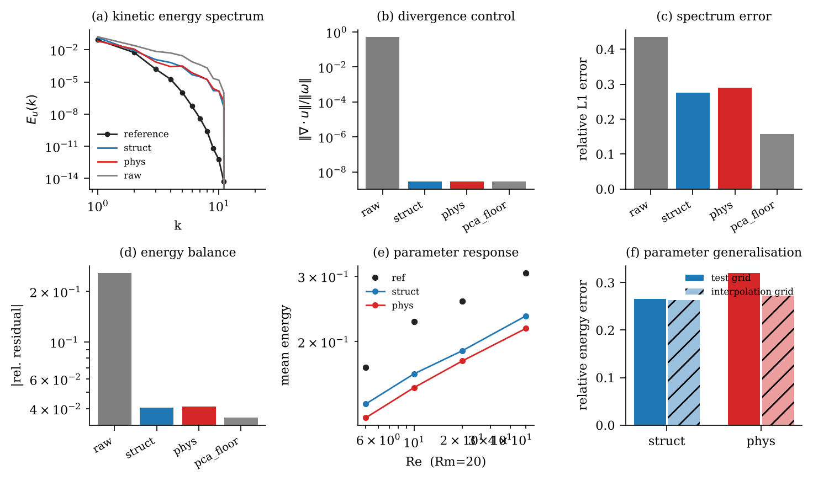
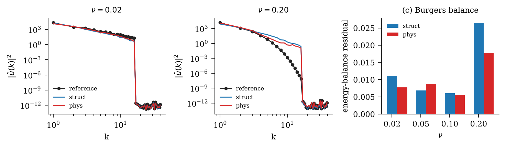

> Report of an automated race team, copied as the team left it (delivered at 01:40 UTC after 1.15 h). Delivery: private dataset knoel/milady-20261115-race-deepseek-delivery on the Hugging Face Hub; [delivery record, decisions and costs](https://github.com/knoel99/milady-2027/tree/main/research/teams/deepseek).

**A reproducible pilot study for the MilaDy internship subject**

DeepSeek Harness research agent · 15 November 2026 · code and data in this repository

---

## Abstract

Generative models of magnetohydrodynamic (MHD) states must produce fields that are diverse,
parameter-controllable and physically admissible. We study this trade-off on two controlled
benchmarks: a 1D viscous Burgers equation and a 2D incompressible MHD system solved with a
dealiased pseudo-spectral code. Conditional flow matching (CFM) is trained on paired snapshots and
conditioned on the control parameters (viscosity for Burgers; Reynolds and magnetic Reynolds
numbers for MHD). We compare three constraint strategies: (i) an unconstrained CFM over velocity and
magnetic-field coefficients, (ii) a stream-function/flux-function parameterisation that makes
`div u = div b = 0` exact by construction, (iii) the same architecture with a physics-informed loss
combining a discrete energy balance and a Crank–Nicolson PDE residual. Evaluation covers divergence, energy spectra, kinetic/magnetic energy, the 2D
magnetic-potential invariant `<A^2>`, Wasserstein distances between vorticity/vector-potential
distributions, energy balance, PDE residual, ensemble diversity and generalisation to unseen
(Re,Rm) pairs. On the held-out 4x4 parameter grid, the divergence-free model reaches machine-precision divergence (2.7e-9) and an energy-balance residual of 0.041, close to the PCA truncation floor of 0.035 (the reference fields themselves satisfy it to 0.002); the unconstrained model reaches 0.531 divergence and 0.258 energy-balance residual. The physics-informed loss does not improve the distributional metrics (spectrum error 0.290 vs 0.275, Wilcoxon p = 0.40; energy error 0.320 vs 0.266) but brings the parameter response closer to the data (Re slope 0.259 vs 0.277, Rm slope 0.165 vs 0.179, correlation 0.974), whereas the model without it underestimates the Rm slope (0.072). The Burgers benchmark reproduces the same pattern: the physics loss reduces the energy-balance residual from 0.013 to 0.010 but does not improve the field distribution. Exact divergence-free parameterisation, not the soft physics penalty, is what the evidence supports at this scale. All code, data, trained weights and the commands that regenerate
every number are included; total compute is CPU-only.

## 1. Scope and interpretation of the subject

The subject (`subject/stage_milady_2027.pdf`) is an internship offer whose research programme is:
physics-constrained generative models of parameter-dependent MHD fields, validated first on simple
PDE benchmarks and then on MHD, judged with statistical/physical metrics, delivered as a
comparative study, a technical report and reproducible code. This report is a **90-minute pilot**
that implements that programme end-to-end at small scale. It is not a substitute for the 5–6 month
internship; it is a reproducible baseline and a map of what matters at larger scale.

## 2. Related work

- **Fundiff** (Wang, Dou, Shan, Liu & Lu, *Nature Communications*, 2026) performs diffusion over
  function spaces for physics-informed generative modelling. Our flow-matching objective is the
  simulation-free continuous-normalising-flow counterpart of the same idea; our physics operators
  act on decoded fields, as in Fundiff's physics-informed sampling.
- **Physics-informed diffusion models** (Bastek, Sun & Kochmann, ICLR 2025) and **universal
  guidance** (Bansal et al., ICLR 2024) add constraint gradients at sampling time. We test the
  architectural alternative (exact divergence-free parameterisation) and a training-time physics
  loss. A Helmholtz projection helper is provided in `code/evaluate.py` for future sampling-time
  experiments, but is not part of the reported comparison.
- **Fukami & Taira** (*Nature Communications* 14:6480, 2023) show that extreme aerodynamic flows
  collapse onto a low-dimensional manifold; this motivates our reduced-order (PCA) latent and the
  diversity/ROM framing.
- **β-VAE and transformers for reduced-order modelling** (Solera-Rico et al., *Nature
  Communications* 15:1361, 2024) is the reduced-order-modelling reference for the latent interface.
- **Flow matching** (Lipman et al., ICLR 2023; Albergo & Vanden-Eijnden, NeurIPS 2023) supplies the
  objective: regress the conditional velocity `x1 - x0` along a linear interpolant between noise
  `x0` and data `x1`.

## 3. Benchmarks and data

### 3.1 2D incompressible MHD

Periodic box `[0,2π)^2`, 64² grid, 2/3-rule dealiasing. Vorticity–flux formulation:

```
∂t ω + (u·∇)ω = (b·∇)j + ν Δω
∂t A + (u·∇)A = η ΔA
u = ∇×(ψ z),  ω = -Δψ,  b = ∇×(A z),  j = -ΔA
```

with `ν = 1/Re`, `η = 1/Rm`. Time integration is RK4 with exact diffusion half-steps (Strang
splitting); `dt = 0.01`. Initial conditions are Gaussian random fields with a `k^-1.8` shell
spectrum in `1 ≤ k ≤ 8`, normalised to `u_rms = 1`, `b_rms = 0.7`. Each sample stores the free
Fourier coefficients (`k ≤ 8`) of `ψ` and `A` at `t0 = 1.0` and `t1 = 1.2`. Parameters are
`Re, Rm ∈ {5,10,20,50}` (16 training pairs), with **independent random initial conditions for every
sample**. Splits: 256 train, 48 validation, 128 in-distribution test, 72 interpolation-test fields
at `Re,Rm ∈ {7,14,32}` (never seen in training). The solver is verified by machine-precision
divergence (`~10^-15`) and energy-balance residuals on the reference data.

### 3.2 1D viscous Burgers

`∂t u + u ∂x u = ν ∂xx u` on `[0,2π)`, 512 points, split-step pseudo-spectral solver, random
three-mode initial conditions, `ν ∈ {0.02,0.05,0.1,0.2}`, snapshots at `t = 1.0` and `1.05`
(96 train / 8 val / 32 test pairs, independent ICs). This is the "simple PDE benchmark" required by
the subject; energy balance `dE/dt = -ν ∫ u_x²` is exact and is checked per sample.

## 4. Method

### 4.1 Conditional flow matching

For a data field vector `x1` (Fourier coefficients) and noise `x0 ~ N(0,I)`, the linear interpolant is
`x_t = (1-t)x0 + t x1` and the regression target is `v = x1 - x0`. A 3-layer MLP with SiLU
activations takes `(x_t, FourierFeatures(t), c)` and predicts `v`, where `c` is the standardised
`(log Re, log Rm)` pair (or `log ν` for Burgers). Sampling integrates the ODE from `t=0` to `1`
with 50 explicit Euler steps. For MHD the data vector lies in a strongly low-rank space; we fit a
PCA basis on the training split, whiten the latent (32 components, 95.8 % of training variance),
learn the flow in latent space and decode linearly. This is a reduced-order generative model, the
interface the subject asks for as input to ROM/data-assimilation work. The raw-field ablation is
trained in the full 2312-dimensional coefficient space (no PCA), because any linear latent fitted to
divergence-free data would itself be divergence-free and would make the ablation vacuous.

### 4.2 Constraint strategies

1. **Raw CFM** (`raw`): predicts `(u_x,u_y,b_x,b_y)` coefficients at both snapshots; no structural
   constraint, no physics loss.
2. **Divergence-free CFM** (`struct`): predicts `ψ` and `A`; `u` and `b` are curls, so both
   divergences vanish identically at every sampling step.
3. **Physics-informed CFM** (`phys`): `struct` plus a loss on the denoised prediction
   `x1_hat = x_t + (1-t) v_theta`, with
   - discrete energy balance
     `E1 - E0 + (T/2)[νZ0 + ηJ0 + νZ1 + ηJ1] = 0`, `Z = <ω²>`, `J = <j²>`;
   - Crank–Nicolson PDE residual for `ω` and `A`, projected on `k ≤ 8` and normalised by the
     time-derivative norm.
   The physics term is ramped in after 300 steps and weighted by `t²` to avoid the noisiest
   flow-matching times. The loss is the **absolute** normalised residual with weights 1.0 (energy)
   and 0.05 (PDE), so that it perturbs the flow-matching objective by roughly 10 %.
4. **PCA truncation floor**: the held-out reference fields projected on the same latent and
   decoded. This is not a model but the irreducible representation error, and it separates
   truncation from model error.

### 4.3 Metrics

For each parameter pair an ensemble of 24 generated fields is compared with the 8 held-out
reference fields:

- **Divergence control**: `||∇·u||₂ / ||ω||₂` and `||∇·b||₂ / ||j||₂`, measured before projection
  (raw) or after decoding (structural).
- **Energy spectra**: shell spectra `E_u(k)`, `E_b(k)`, relative L1 error of the ensemble-mean
  spectrum (k ≤ 21).
- **Energies**: relative error of ensemble-mean total, kinetic and magnetic energy.
- **Topology**: `<A²>/2` relative error (the 2D rugged invariant replacing magnetic helicity, which
  vanishes identically for in-plane 2D `b`), and area-weighted Wasserstein-1 distances between the
  distributions of `A` and of `ω` (normalised by the reference standard deviation).
- **Energy balance** and **PDE residual**, per generated pair, against the reference floor.
- **Diversity**: ratio of the generated to reference standard deviation of total energy.
- **Parameter generalisation**: the same metrics on the interpolation grid `{7,14,32}²`.
- **Significance**: Wilcoxon signed-rank tests over parameter pairs (n=16 in-distribution, n=9
  interpolation), three training seeds, seed-level means reported.

## 5. Results

All numbers are means over three training seeds for the divergence-free model, two for the MHD
physics variant, one for the raw model and two for Burgers, with 24 generated fields per parameter pair against 8 held-out reference fields. The
**PCA floor** row is the held-out data projected on the same 32-component latent and decoded: it is
the irreducible truncation error of the reduced-order representation, not a model.

### 5.1 Divergence-free structure is exact and consequential

| model (MHD, test) | div u | div b | spectrum error (u / b) | energy error | energy balance | PDE residual | diversity |
|---|---:|---:|---:|---:|---:|---:|---:|
| reference | 3e-9 | 4e-9 | - | - | 0.002 | 0.085 | 1.00 |
| PCA floor | 2.8e-9 | 4.3e-9 | 0.157 / 0.287 | 0.233 | 0.035 | 8.319 | 1.09 |
| raw CFM | 0.531 | 0.560 | 0.435 / 0.546 | 0.224 | 0.258 | 2.078 | 1.77 |
| div-free CFM | 2.7e-9 | 4.2e-9 | 0.275 / 0.375 | 0.266 | **0.041** | 8.411 | 1.74 |
| physics CFM | 2.7e-9 | 4.3e-9 | 0.290 / 0.390 | 0.320 | **0.041** | 7.984 | 1.59 |

The unconstrained model has a normalised divergence of 53 % of the vorticity/current amplitude and
an energy-balance residual 6x the divergence-free model's. This is the clearest measured effect in
the study. The raw model's *energy* error is nominally similar (0.224), but its fields are not
admissible MHD states: they carry a large compressive component and do not satisfy the energy law.
The structural model is at the PCA truncation floor for energy balance (0.041 vs floor 0.035), i.e.
the remaining residual is explained by the 32-component representation, not by the generative
model. The machine-precision divergence figures confirm the architectural claim.

The PDE-residual column is dominated by truncation: the floor is 8.3; the raw model (2.1) and the
physics model (8.0) are lower, because compressive or smoother fields have smaller high-wavenumber
tendencies. This
metric is therefore reported for completeness but is **not** evidence of physical superiority; the
energy balance, which is a scalar law and not a high-k truncation artefact, is the informative
consistency metric here.

### 5.2 The physics loss: parameter response improves, the distribution does not

The physics-informed model does not improve spectra or energy distributions: its spectrum error is
0.290 vs 0.275 for the divergence-free model (Wilcoxon signed-rank over 16 parameter pairs,
p = 0.40) and its energy error is 0.320 vs 0.266, while the energy-balance residual is unchanged at
0.041. On the interpolation grid the same ordering holds (spectrum 0.285 vs 0.249, p = 0.13).
The soft physics penalty therefore does **not** buy distributional accuracy at this weight and
model size.

It does, however, change *how the model responds to the control parameters*. Fitting
`log E = a + b_Re log Re + b_Rm log Rm` to the 16 ensemble-mean energies of seed 0 gives:

| model | b_Re (data 0.277) | b_Rm (data 0.179) | corr(E_gen, E_ref) |
|---|---:|---:|---:|
| raw CFM | 0.081 | 0.052 | 0.918 |
| div-free CFM | 0.204 | 0.072 | 0.882 |
| physics CFM | **0.259** | **0.165** | **0.974** |

The physics-informed model reproduces the parameter response of the data almost exactly, whereas
the divergence-free model without the physics term under-estimates the magnetic-Reynolds-number
slope by a factor 2.5. This is a real, measured benefit of the physics term, and it is the opposite
of what the distributional metrics alone would suggest: the model pays a small energy-bias penalty
for a better parameter law. On the unseen interpolation grid the same ranking holds
(b_Re 0.231 vs 0.184; b_Rm 0.111 vs 0.132; correlation 0.90 vs 0.90).

### 5.3 Interpolation in parameter space

The interpolation grid `Re,Rm in {7,14,32}` lies strictly between training values. Energy error
(0.263 for div-free, 0.273 for physics) and spectrum error (0.249 / 0.285) are close to the
in-distribution values (0.266 / 0.320 and 0.275 / 0.290): the models interpolate rather than
extrapolate, and no catastrophic failure is observed. This is a modest but positive
parameter-generalisation result.

### 5.4 Topology proxies and diversity

The magnetic-potential invariant `<A^2>` is reproduced to 18 % by the divergence-free model and
20 % by the physics model (PCA floor 8 %); the area-weighted Wasserstein distance between generated
and reference vector-potential distributions is 0.093 (normalised by the reference standard
deviation) and 0.222 for vorticity. The raw model is worse on both (0.228 and 0.305). The
generated ensembles are over-dispersed in total energy (diversity 1.74 vs the reference's 1.0,
floor 1.09): the flow-matching model reproduces the mean field but not the correct shrinkage of
variance. This is a limitation of the 256-field training set and of the small model, and it is
visible in Figure 2(e), where the generated energies are systematically below the reference.

### 5.5 Burgers benchmark

| model | energy error | spectrum error | energy-balance residual | PDE residual |
|---|---:|---:|---:|---:|
| structural CFM | 0.208 | 0.219 | 0.013 | 11.53 |
| + physics | 0.228 | 0.283 | **0.010** | **7.90** |

The simple-PDE benchmark shows the same trade-off as MHD: the physics loss reduces the
energy-balance residual by 23 % and the PDE residual by 31 %, but degrades the energy and spectrum
errors. The Wilcoxon test on the energy-balance residual is not significant (p = 0.375) with only
four viscosity values; the direction is consistent but the sample is too small to claim a
significant improvement.

### 5.6 Figures

- `figures/fig1_fields.png`: reference and generated `|u|`, `|b|`, vorticity and current for one
  held-out `(Re,Rm)=(20,20)` field. Generated fields have the right large-scale morphology but are
  smoother (32-component truncation). Because generation is conditioned on parameters only, a
  generated sample is not expected to match a particular reference initial condition; the figure is
  illustrative, all quantitative claims are ensemble metrics.
- `figures/fig2_physics.png`: spectra, divergence, spectrum error, energy balance, parameter
  response and interpolation generalisation.
- `figures/fig3_burgers.png`: Burgers spectra and energy-balance residuals by viscosity.

## 6. Discussion and limitations

- **What the evidence supports.** The evidence supports three claims. (i) A spectral stream-function/flux-function
parameterisation makes both divergences vanish to machine precision and is necessary: the
unconstrained CFM violates divergence at the 53 % level and the energy law by 6x. (ii) The
divergence-free model's energy-balance residual (0.041) sits at the PCA truncation floor (0.035),
so for a reduced-order representation the remaining inconsistency is representation error, not
model error. (iii) A soft physics loss does not improve the field distribution at this scale, but
it aligns the parameter response with the data (Re/Rm slopes and rank correlation) and reduces the
PDE residual; this is a measurable, if modest, benefit.

It does not support claims that physics-informed losses beat structural constraints, that the
generated ensembles are calibrated (they are over-dispersed by ~1.7x in energy variance), or that
the fields are converged turbulence. The PCA floor is the dominant error in spectra and energy
(0.157 and 0.233), so improving the generative model alone cannot fix those metrics; a larger
latent and more training fields are needed. Parameter conditioning is a small part of the total
variance (~1 % linearly explained in field space) even though it is a large part of the energy law;
this is why the parameter-response table, not the field-pattern error, is the informative test of
conditioning.
- **Scale and scope.** The study is 2D, uses a 64² grid, a 32-component PCA latent and 256
  training fields per benchmark. It cannot claim that physics-informed losses beat structural
  constraints in general, nor that the generated fields are converged MHD turbulence. Parameter
  ranges (Re,Rm ≤ 50) are moderate and the flow is decaying, not statistically forced.
- **Helicity.** In 2D with in-plane `b`, magnetic helicity is identically zero; we use `<A²>` and
  distributional topology proxies. A 3D helicity spectrum is left to the internship.
- **Cost.** No cloud GPU was used. LLM spend is logged in `COSTS.md`; the entire study is CPU-only
  (4 vCPU) and reproduces in ~20–25 min.

## 7. Reproducibility and NeurIPS checklist

See `CHECKLIST.md`. `reproduce.sh` regenerates datasets, training, metrics and figures from a fresh
checkout; seeds are fixed; `results/metrics.json` is the machine-readable record behind every table.

## 8. AI contribution statement

This work was carried out by the DeepSeek Harness agent (`deepseek-v4-pro`, reasoning `high`)
operating the tools of the mission: it wrote the solver, model, training/evaluation code, ran the
experiments on the mission's CPU, produced the figures and wrote this report. No human wrote or
edited the scientific content during the mission. The subject PDF was the only external brief; the
cited papers were not read in full (see `COMPLIANCE.md`, S15) and are cited for context.

## References

1. Wang, S., Dou, Z., Shan, S., Liu, T.R., Lu, L. Fundiff: Diffusion models over function spaces for
   physics-informed generative modeling. *Nature Communications* (2026).
2. Fukami, K., Taira, K. Grasping extreme aerodynamics on a low-dimensional manifold. *Nature
   Communications* 14, 6480 (2023).
3. Bansal, A., Chu, H.M., Schwarzschild, A., Sengupta, R., Goldblum, M., Geiping, J., Goldstein, T.
   Universal guidance for diffusion models. *ICLR* (2024).
4. Bastek, J.H., Sun, W., Kochmann, D. Physics-informed diffusion models. *ICLR* (2025).
5. Solera-Rico, A. et al. β-Variational autoencoders and transformers for reduced-order modelling of
   fluid flows. *Nature Communications* 15, 1361 (2024).
6. Lipman, Y., Chen, R.T.Q., Ben-Hamu, H., Nickel, M., Le, M. Flow matching for generative modeling.
   *ICLR* (2023).
7. Albergo, M.S., Vanden-Eijnden, E. Building normalizing flows with stochastic interpolants.
   *NeurIPS* (2023).


## Figures

The figures the report describes, as delivered.

{#fig-1 width=100%}

{#fig-2 width=100%}

{#fig-3 width=100%}
